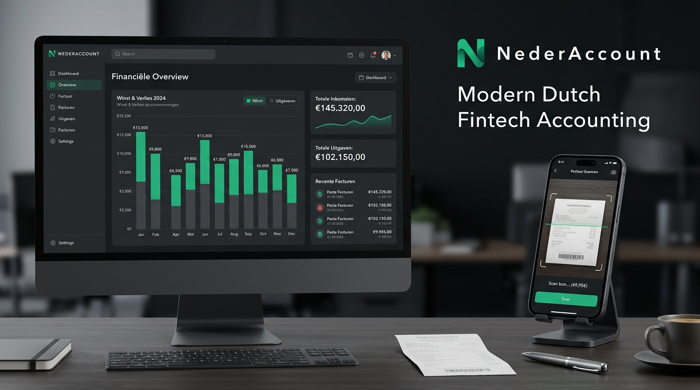

# BoekhoudGemak 📊💼
> **Slimme Boekhouding & Administratie voor Kleine Ondernemers, ZZP'ers en MKB**
> *Nu volledig beschikbaar als Progressive Web App (PWA) met offline ondersteuning en in-app installatie!*

🌐 **Direct online gebruiken**: [**https://boekhoudgemak.lucifera.eu**](https://boekhoudgemak.lucifera.eu)



[](https://boekhoudgemak.lucifera.eu)
[]()
[]()
[]()
[]()
[]()
[]()

---

> 🚀 **Direct naar de app**: Probeer BoekhoudGemak direct uit in uw browser of installeer de applicatie op uw smartphone via [https://boekhoudgemak.lucifera.eu](https://boekhoudgemak.lucifera.eu).

## 🌟 Over BoekhoudGemak

**BoekhoudGemak** is een moderne, alles-in-één boekhoudkundige web- en mobiele applicatie speciaal ontworpen voor zelfstandige ondernemers (zzp'ers) en het midden- en kleinbedrijf (mkb). Het automatiseert tijdrovende administratieve taken, van het scannen van bonnetjes met Machine Learning tot het realtime berekenen en direct digitaal indienen van de periodieke omzetbelasting bij de Belastingdienst.

---

## 📱 Progressive Web App (PWA) Mogelijkheden

BoekhoudGemak is gebouwd als een volwaardige **Progressive Web App (PWA)** volgens de modernste standaarden:

- 📲 **In-App Installatie**: Installeer de app met één klik via de **"Installeer App"** knop in de navigatiebalk of op het dashboard, zonder tussenkomst van de App Store of Google Play Store.
- ⚡ **Standalone Native Experience**: Draait als een zelfstandige mobiele of desktop applicatie zonder browserbalken, met vloeiende animaties en een native look & feel.
- 📴 **100% Offline Ondersteuning**: Blijf bonnen toevoegen, facturen inzien en uw cijfers raadplegen, zelfs in de trein of in gebieden met slecht bereik. Wijzigingen worden lokaal gebufferd en automatisch gesynchroniseerd zodra de verbinding herstelt.
- 🚀 **Service Worker Pre-caching (Workbox)**: Alle assets, interfaces en Google Fonts worden lokaal gecachet voor bliksemsnelle laadtijden (&lt; 0.5s).
- 🧭 **App Shortcuts**: Snelle acties direct vanaf het beginscherm van uw smartphone:
  - *Bon Scannen* (direct de camera openen)
  - *BTW-Aangifte* (direct naar de kwartaalaangifte)
  - *Winst & Verlies* (direct financieel overzicht)
- 📐 **Volledige Icoonenset**: Inclusief 192x192px, 512x512px, Android Maskable iconen met safe-zone padding en `apple-touch-icon.png` voor iOS Safari.

### Installatiegids per platform
1. **Android (Chrome / Brave / Edge)**: Tik op de in-app knop **"Installeer App"** of kies in het browsermenu voor *"App installeren"*.
2. **iPhone / iPad (iOS Safari)**: Tik op het deelicoon (vierkantje met pijl omhoog) en kies **"Zet op beginscherm"**.
3. **Windows / macOS (Chrome / Edge)**: Klik op het installatie-icoon rechts in de adresbalk of gebruik de in-app installeerknop.

---

## 🚀 Kernfunctionaliteiten

### 1. 📷 Automatische Factuur- en Bonnetjesscanner (AI OCR)
- **Mobiele cameraweergave** met realtime richtkader en automatische detectie van documentgrenzen.
- **AI OCR extractie**: Herkent leverancier, datum, factuurnummer, totaalbedrag, btw-tarief (21%, 9%, 0%), aftrekbare voorbelasting en categorie.
- **Fiscale rubriektoewijzing**: Wijst inkopen direct toe aan de juiste Belastingdienst rubriek (o.a. Rubriek 5b Voorbelasting).
- **Directe testbonnen**: 1-klik tests met o.a. Shell brandstofbon, Coolblue hardware factuur, zakelijke lunch (80% IB aftrekbaar) en software abonnementen.

### 2. 📈 Realtime Winst- en Verliesdashboard (P&L)
- **Financiële KPI's**: Realtime overzicht van totale omzet, operationele kosten, netto winst met marge en geschatte belastingreservering.
- **Interactieve grafieken**: Maandelijkse ontwikkeling van inkomsten en uitgaven (2026 en kwartalen).
- **Cashflow prognose (90 dagen)**: Gebaseerd op openstaande facturen en terugkerende vaste lasten.
- **Budgetbewaking**: Automatische alerts bij het bereiken of overschrijden van categoriebudgetten.
- **Dagelijkse ondernemerstaken**: Interactieve productiviteitschecklist voor uw dagelijkse administratie.

### 3. 🏛️ Automatische BTW-Aangifte (Belastingdienst)
- **Officiële structuur**: Rubrieken 1a t/m 1e (binnenland), 2a (verlegd), 3a/b (export), 4a/b (import) en 5a t/m 5e (eindberekening).
- **Direct indienen via Digipoort**: Eén-klik verzendsimulatie met DigiD/eHerkenning validatie, ontvangstbevestiging en transactiekenmerk.
- **Downloadbare Aangifte**: Exporteer de officiële aangifte direct in XML- en JSON-formaat.
- **Inkomstenbelasting Box 1 calculator**: Berekening inclusief zelfstandigenaftrek (€ 3.750) en MKB-winstvrijstelling (12,7%).
- **KOR-indicator**: Automatische signalering of uw omzet onder de € 20.000 drempel van de kleineondernemersregeling blijft.

### 4. 📁 Veilige Export naar Accountant & Boekhouder
- **Auditfile Financieel (XAF 3.2 XML)**: Volgens de officiële Nederlandse SBR-taxonomie (compatibel met Exact Online, Twinfield, SnelStart, SRA en NOAB).
- **UBL 2.1 e-Facturatie**: Direct downloaden van e-facturen conform Peppol standaarden.
- **Excel & CSV Export**: Tabellarische journaalposten met IBANs, grootboekrekeningen en btw-bedragen.
- **Printklaar PDF-jaarrapport**: Professionele winst- en verliesrekening met datum- en verificatiestempel.
- **Boekhouder Uitnodigen**: Verstuur een beveiligde deellink rechtstreeks per e-mail.

### 5. 🏦 PSD2 Bankkoppelingen & Transactieverwerking
- **Ondersteunde banken**: Directe API-koppelingen met **ING Zakelijk, Rabobank, Bunq en ABN AMRO**.
- **Geautomatiseerde reconciliatie**: Automatisch afletteren van inkomende en uitgaande betalingen met openstaande facturen.
- **Machine Learning Categorisering**: Automatische classificatie met betrouwbaarheidsscore.
- **CAMT.053 & MT940 Import**: Ondersteuning voor het inlezen van officiële bankafschriften.
- **Anomalie-detectie**: Automatische waarschuwingen bij ongebruikelijke afschrijvingen of missende bonnen.

### 6. 🔐 Beveiliging, 2FA, Biometrie & AVG/GDPR
- **Tweefactorauthenticatie (2FA)**: Beveiliging met 6-cijferige TOTP-codes (Google Authenticator, Microsoft Authenticator, 1Password).
- **Biometrische toegang**: Ondersteuning voor FaceID, TouchID en vingerafdrukontgrendeling.
- **AVG / GDPR Compliance Hub**:
  - Recht op inzage en dataportabiliteit (1-klik volledige JSON export).
  - Recht op gegevenswissing (fabrieksherstel en veilige cache-wissing).
  - Gedeponeerde Verwerkersovereenkomst (DPA).
- **Versleutelde Cloud Back-up (AES-256)**: Automatische cloud synchronisatie met Google Drive, Dropbox en OneDrive.

### 7. 🌐 Toegankelijkheid, Donkere Modus & Meertaligheid
- **Donkere & Lichte Modus**: Volledig geoptimaliseerd contrast voor optimaal leescomfort.
- **Toegankelijkheidsbalk (A11y)**: Instelbare lettergroottes (normaal, groot, extra groot) en Hoog Contrast modus voor visueel beperkten.
- **Tweetalig**: Schakel met één klik tussen Nederlands (NL) en Engels (EN).
- **Google Agenda Koppeling**: Voeg fiscale deadlines direct toe aan uw Google Agenda.

---

## 🛠️ Technische Architectuur

- **Frontend**: React 19, TypeScript, Tailwind CSS v4, Lucide Icons, Canvas Confetti.
- **PWA Tooling**: `vite-plugin-pwa`, Workbox precaching, Service Worker lifecycle management, Web App Manifest.
- **Backend**: Node.js, Express, TSX.
- **AI & OCR Engine**: Google Gemini API (`@google/genai` met `gemini-3.8-flash`) voor factuuranalyse en Machine Learning transactiecategorisering.
- **Offline Opslag**: Browser LocalStorage met snapshot encryptie en synchronisatiewachtrij.
- **SEO & Social**: Volledige OpenGraph tags, Twitter Cards en Schema.org (`WebApplication`) gestructureerde data.

---

## 📦 Installatie & Lokaal Draaien

### Vereisten
- Node.js (v18 of hoger)
- npm of yarn

### Stappen
1. Clone de repository en installeer afhankelijkheden:
   ```bash
   npm install
   ```

2. Configureer uw omgevingsvariabelen in `.env` (zie `.env.example`):
   ```env
   GEMINI_API_KEY="uw_gemini_api_sleutel"
   PORT=3000
   ```

3. Start de ontwikkelserver (met PWA service worker actief in dev):
   ```bash
   npm run dev
   ```

4. Open uw browser op: `http://localhost:3000`

---

## 🔒 Privacy & Veiligheid (AVG)

BoekhoudGemak slaat financiële transacties lokaal op met client-side encryptie en verwerkt documenten uitsluitend via beveiligde, versleutelde verbindingen. Uw administratie blijft altijd in uw beheer conform de Europese Algemene Verordening Gegevensbescherming (AVG / GDPR).

---

## 📄 Licentie

Gelicentieerd onder de Apache-2.0 Licentie.
